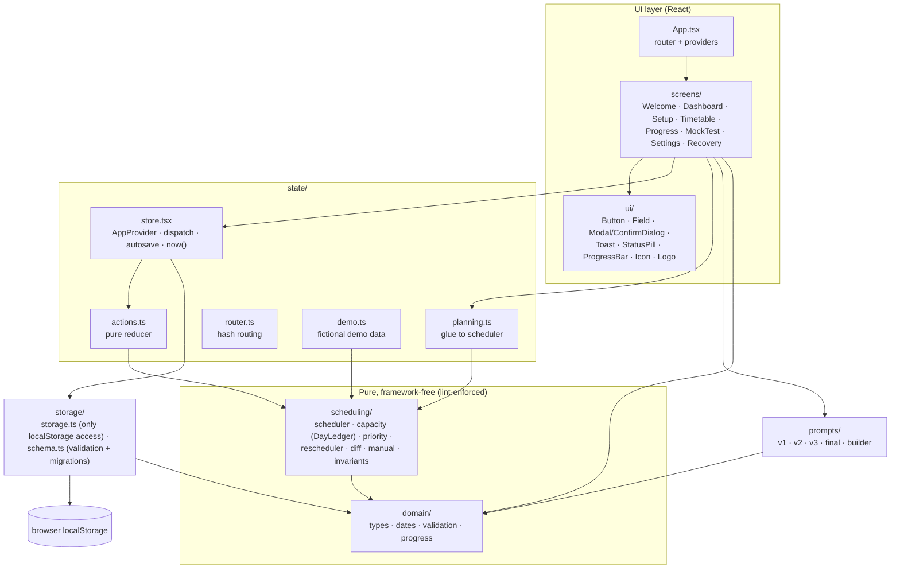
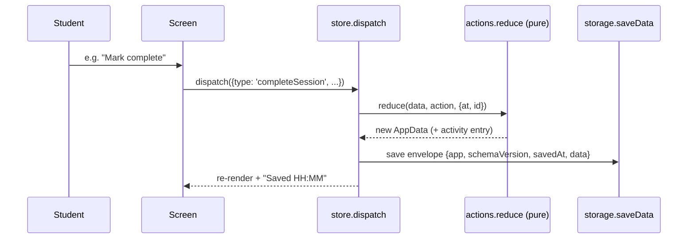
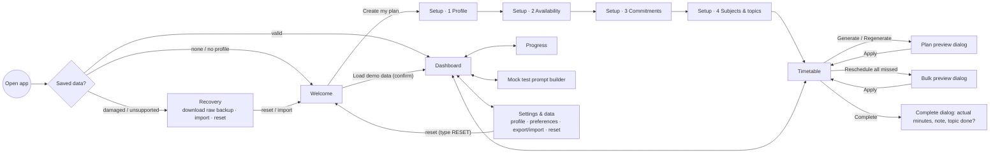

# StudySync architecture

These diagrams describe the code as it was built.

## Module architecture

Rules enforced by ESLint (`eslint.config.js`):

- `src/domain/**` and `src/scheduling/**` may not import React, `storage/`, `state/`, `ui/` or `screens/`.
- They may not use `window`, `document`, `localStorage`, `sessionStorage`, `Date.now()` or `new Date()` with no arguments. "Now" is passed in as a `LocalNow { date, minutes }`.
- Only `src/storage/storage.ts` reads or writes browser storage.

## Data flow for a change

Generating a plan works the same way. `planning.computePlan` calls the pure `generatePlan` with the current `LocalNow`. The Timetable screen shows a diff preview made by `diffPlans`, and only `applyPlan` changes the data.

## Screen flow

Navigation uses a sidebar at 900 px and wider, and a top bar plus bottom navigation below that. Every screen is a hash route (`#/dashboard`, `#/setup/subjects`, `#/timetable`, `#/progress`, `#/mock-test`, `#/settings`), so moving between screens never reloads the page.
